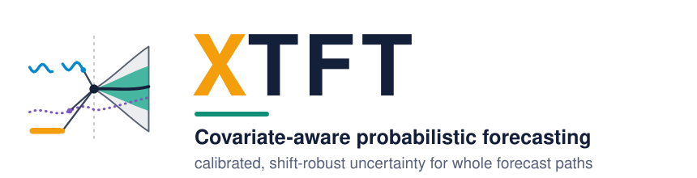

<div align="center">
  <picture>
    <source media="(prefers-color-scheme: dark)" srcset="docs/_static/logo/xtft-logo-dark.svg">
    
  </picture>
  <br/>
  <em>Forecast many related time series at once, with static, observed and known-future inputs, and with intervals that keep the coverage they claim.</em>
  <br/><br/>
  <a href="https://github.com/earthai-tech/xtft/actions/workflows/tests.yml"></a>
  <a href="https://xtft.readthedocs.io/en/latest/"></a>
  <a href="https://codecov.io/gh/earthai-tech/xtft"></a>
  <a href="https://github.com/earthai-tech/xtft/actions/workflows/lint.yml"></a>
  <a href="https://opensource.org/licenses/BSD-3-Clause"></a>
  <br/>
  
  
  
  
  <a href="https://github.com/astral-sh/ruff"></a>
  <br/><br/>

**[Documentation](https://xtft.readthedocs.io)** ·
[Quick start](#-quick-start) ·
[Examples](https://xtft.readthedocs.io/en/latest/auto_examples/index.html) ·
[API](https://xtft.readthedocs.io/en/latest/api/index.html) ·
[Contributing](CONTRIBUTING.md)

</div>

---

## 🧭 Why XTFT?

Panels of related series often share covariates: sales of many
products with prices and promotions, electricity prices with load
forecasts, river flow in many basins with weather. **XTFT**, the
eXogenous-aware Temporal Fusion Transformer, is built for them. It
extends the Temporal Fusion Transformer where such panels break
it, and ships a calibration layer that works for **any** model.

| | |
|---|---|
| 🧩 **Three kinds of input** | static attributes, observed past covariates and inputs known in advance, weighed by variable selection at every step |
| 🌊 **Level shift** | reversible instance normalisation of each window, so forecasts follow a level never seen in training |
| 🕳️ **Missing inputs** | pass gaps as `NaN`; masks, a learned decay and missingness-aware embeddings handle them inside the model |
| 📐 **Non-crossing quantiles** | a monotone head returns ordered quantiles by construction |
| 🛰️ **Calibration** | split-conformal and adaptive conformal intervals for the forecasts of any model |
| 🛤️ **Whole-path bands** | bands that contain the entire forecast path with the stated probability |

## 🚀 Installation

```bash
pip install "xtft[torch]"
```

Requires **Python 3.10+**. Until the first release is on PyPI,
install from the repository (below).

<details>
<summary><b>Optional extras, GPUs &amp; source install</b></summary>

| Extra | Installs | For |
|---|---|---|
| `torch` | PyTorch ≥ 2.1 | the XTFT model, training and inference |
| `tf` | TensorFlow 2.20 / Keras 3 | the Keras XTFT and TFT ported from fusionlab-learn |
| `bench` | neuralforecast, statsforecast, LightGBM, … | the benchmark scripts |
| `test`, `docs` | pytest, Sphinx and extensions | tests and documentation |

For a GPU, install the PyTorch build matching your CUDA driver from
[pytorch.org](https://pytorch.org/get-started/locally/) first.

From the repository:

```bash
git clone https://github.com/earthai-tech/xtft.git
cd xtft
pip install -e ".[torch,dev,test]"
pytest
```

</details>

## ⚡ Quick start

```python
from xtft.nn.torch.models import XTFT

model = XTFT(
    static_input_dim=4,
    dynamic_input_dim=5,       # past targets first, then covariates
    future_input_dim=2,
    forecast_horizon=24,
    quantiles=[0.1, 0.5, 0.9],
    instance_norm=True,
)
q = model(x_static, x_dynamic, x_future)   # (batch, 24, 3)
```

Shapes: `x_static` `(B, S)`, `x_dynamic` `(B, T, D)` with `NaN`
for missing values, `x_future` `(B, T + H, F)`.

<details>
<summary><b>From a data frame to trained forecasts</b></summary>

```python
import numpy as np
from xtft.data import PanelData, PanelSpec, WindowDataset
from xtft.nn.torch.trainer import TrainConfig, fit, predict

# Long format: one row per series and time step.
spec = PanelSpec(static=("area",), past=("temp",), known=("dow_sin", "dow_cos"))
panel = PanelData.from_frame(df, spec)
val_start = panel.split_index(val_cutoff)     # per-series indices
test_start = panel.split_index(test_cutoff)
panel.fit_scaling(val_start)                  # training statistics only

T, H = 56, 14
first = np.zeros(panel.n_series, dtype=np.int64)
train_ds = WindowDataset(panel, panel.origins(first, val_start, T, H, 1), T, H)
val_ds = WindowDataset(panel, panel.origins(val_start - 1, test_start, T, H, 1), T, H)

history = fit(model, train_ds, val_ds, quantiles,
              TrainConfig(max_epochs=50, patience=5, device="auto"))
q_val = predict(model, val_ds)                # (N, H, O, K), scaled units
```

The full, runnable version is the example
[Forecast a panel of series](https://xtft.readthedocs.io/en/latest/auto_examples/plot_01_quickstart.html).

</details>

<details>
<summary><b>Calibrate the quantiles of any model</b></summary>

```python
from xtft.evaluation import (
    AdaptiveConformalCalibrator,
    SimultaneousConformalBand,
    path_coverage,
)

# Per-step intervals that adapt when errors drift.
aci = AdaptiveConformalCalibrator(quantiles, gamma=0.005)
q_cal = aci.fit(y_val, q_val).transform(y_test, q_test, times)

# A band that contains the whole forecast path 90% of the time.
band = SimultaneousConformalBand(quantiles, coverage=0.9)
lower, upper = band.fit(y_val, q_val).transform_online(y_test, q_test, times)
path_coverage(y_test, lower, upper)
```

Arrays only: `y` `(N, H)`, `q` `(N, H, K)`, `times` `(N,)`. For a
panel, calibrate each series separately.

</details>

<details>
<summary><b>Score and compare forecasters</b></summary>

```python
from xtft.evaluation import (
    diebold_mariano,
    evaluate_quantile_forecast,
    friedman_nemenyi,
)

evaluate_quantile_forecast(y_test, q_cal, quantiles)
# -> pinball, crps_q, coverage_80, winkler_80, mae, ...

diebold_mariano(crps_a, crps_b, horizon=1)   # two models
friedman_nemenyi(scores)                      # many models, many tasks
```

</details>

<details>
<summary><b>Training on GPU, mixed precision, long panels</b></summary>

```python
cfg = TrainConfig(
    device="auto",          # CUDA if available, else CPU ("mps" on Apple)
    amp="bf16",             # or "fp16" on CUDA
    steps_per_epoch=200,    # random batches per epoch for millions of windows
    seed=0,
)
```

</details>

<details>
<summary><b>Keras backend</b></summary>

```python
import xtft

xtft.set_backend("tensorflow")     # or XTFT_BACKEND=tensorflow
from xtft.nn import XTFT, TFT      # Keras classes, from fusionlab-learn
```

The PyTorch path never imports TensorFlow, and `xtft.evaluation` and
`xtft.data` import neither framework.

</details>

## 📚 Documentation

| | |
|---|---|
| [Getting started](https://xtft.readthedocs.io/en/latest/getting_started/index.html) | installation, first forecast, backends |
| [User guide](https://xtft.readthedocs.io/en/latest/user_guide/index.html) | data, the model and its equations, training, missing data, calibration, evaluation |
| [Examples](https://xtft.readthedocs.io/en/latest/auto_examples/index.html) | runnable scripts with figures, as Python files or notebooks |
| [API reference](https://xtft.readthedocs.io/en/latest/api/index.html) | every public class and function |

## 📊 Benchmarks

[`benchmarks/`](benchmarks/README.md) compares XTFT with TFT,
PatchTST, NBEATSx, DLinear, LSTM, LightGBM, LEAR and statistical
baselines under one protocol (same inputs, horizons, origins and
training budget; several seeds; shared metrics and calibration), on
electricity prices, retail sales, long-horizon series and CAMELS-US
streamflow.

```bash
pip install -e ".[torch,bench]"
python benchmarks/run.py --dataset EPF-DE --model xtft --horizon 24
```

## 🤝 Contributing

Issues and pull requests are welcome. See
[CONTRIBUTING.md](CONTRIBUTING.md) for the development setup, the
checks and the release process; work on the `dev` branch.

## 📝 Citing

A paper describing XTFT is in preparation; until it is published,
please cite this repository.

## ⚖️ Licence

BSD-3-Clause, see [LICENSE](LICENSE). The Keras models and their
support code come from
[fusionlab-learn](https://github.com/earthai-tech/fusionlab-learn);
see [PORTING.md](PORTING.md).
